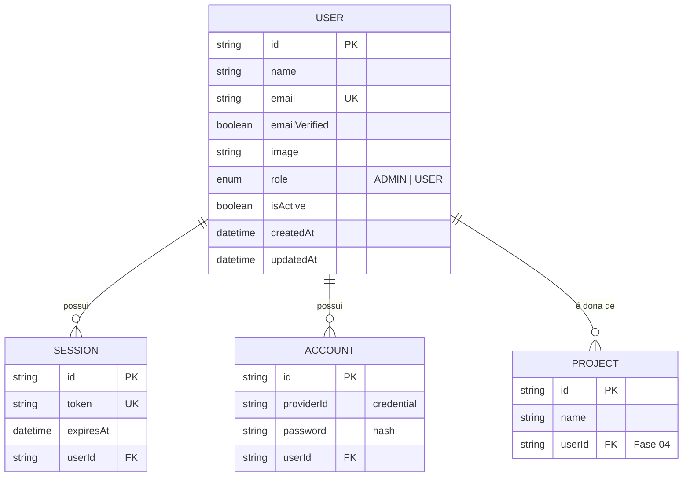

# Passo 03 — Modelagem de dados e ERD

> **Fase:** 02 — Banco e Prisma\
> **Tempo estimado:** 45 a 60 min\
> **Depende de:** [Passo 02](02-projeto-supabase.md)

## Objetivo

Definir **no papel** as entidades da primeira versão e as regras de
modelagem, e desenhar o diagrama entidade-relacionamento (ERD), antes de
escrever qualquer `schema.prisma`.

## 💡 Por que desenhar antes de codar

A planta da casa vem antes do tijolo. Mudar uma parede na planta custa uma
borracha; mudar depois de construída custa uma reforma. No banco, a
“reforma” é uma migration que mexe em dados reais.

O ERD responde, de forma visual: **quais tabelas existem**, **o que cada uma
guarda** e **como se ligam** (cardinalidade).

## Pré-requisitos

- Passo 02 concluído.

## Passo a passo

### 1. Entidades da primeira versão

| Domínio | Entidade | Tabela | Fase | Responsável pela estrutura |
|---|---|---|---|---|
| Identidade | `User` | `user` | **02** | Projeto + Better Auth |
| Identidade | `Session` | `session` | 03 | Better Auth (gerada pelo CLI) |
| Identidade | `Account` | `account` | 03 | Better Auth — guarda o hash da senha |
| Identidade | `Verification` | `verification` | 03 | Better Auth |
| Segurança | `RateLimit` | `rateLimit` | 03 | Better Auth |
| Projetos | `Project` | `project` | 04 | Projeto |
| PDI / Financeiro | `Goal`, `ActionItem`, `Transaction`, `Category` | — | Expansão | Projeto |

Nesta fase, **somente `User`** vai para o banco. O resto fica documentado
no ERD como planejado.

### 2. O modelo `User`, campo a campo

| Campo | Tipo | Regra | 💡 Por quê |
|---|---|---|---|
| `id` | `String` (PK) | Gerado pela aplicação | O Better Auth gera seus próprios IDs; o banco não precisa de `@default` |
| `name` | `String` | Obrigatório | Exibido no Header |
| `email` | `String` | Obrigatório, **único** | Chave de login. Unicidade garantida **pelo banco**, não só pelo código |
| `emailVerified` | `Boolean` | Padrão `false` | Campo exigido pelo Better Auth |
| `image` | `String?` | Opcional | Avatar futuro |
| `role` | `UserRole` (enum) | Padrão `USER` | Autorização explícita, mesmo com uma só administradora (seção 11.8) |
| `isActive` | `Boolean` | Padrão `true` | Permite **desativar** uma conta sem apagá-la |
| `createdAt` / `updatedAt` | `DateTime` | Automáticos | Auditoria básica |

💡 **Por que `enum` e não `String` em `role`?** O enum é uma lista fechada:
o banco recusa `"ADMN"` digitado errado. Com `String`, qualquer texto entraria.

### 3. Regras de modelagem do projeto (ARCHITECTURE.md, seção 13.2)

| Regra | Aplicação |
|---|---|
| Nomes de tabela | `@@map("user")`: tabela em minúsculas, modelo em PascalCase. É o padrão do Better Auth |
| Dinheiro | **Sempre `Decimal`**, nunca `Float` (`0.1 + 0.2 ≠ 0.3` em ponto flutuante) |
| Datas | Gravar em **UTC** (padrão do PostgreSQL/Prisma) e converter para `America/Sao_Paulo` só na exibição |
| Propriedade | Toda entidade de domínio terá `userId` (dona do registro) |
| Exclusão | Definir `onDelete` explicitamente em toda relação (`Cascade`, `Restrict` ou `SetNull`) |
| Índices | Em toda chave estrangeira e em campos de busca frequente |

### 4. ERD da primeira versão

Diagrama em Mermaid (o GitHub renderiza automaticamente):



Leitura: `||--o{` significa **um para muitos**. Um usuário pode ter zero
ou mais sessões, mas cada sessão pertence a exatamente um usuário.

### 5. Desenhar no Draw.io

1. Abra <https://app.diagrams.net/>.
2. Crie o diagrama com as entidades acima (use as formas da categoria
   **Entity Relation**).
3. Salve como `docs/architecture/database-erd.drawio`.

💡 O Mermaid acima serve de consulta rápida; o arquivo `.drawio` é o
documento oficial (seção 13.3). Mantenha os dois sincronizados com o
`schema.prisma`.

## Arquivos criados ou alterados

| Arquivo | Ação | Descrição |
|---|---|---|
| `docs/architecture/database-erd.drawio` | Criado | Diagrama ER oficial |

## ✅ Como testar

| # | Teste | Resultado esperado |
|---|---|---|
| 1 | Abrir o `.drawio` | `User`, `Session`, `Account` e `Project` com PK, FK e cardinalidades |
| 2 | Revisão | Cada campo do `User` tem tipo e regra definidos (tabela do item 2) |

**Critério de aceite:** o ERD está salvo e coerente com a tabela do item 2.

## Commit sugerido

```bash
git add docs/architecture/database-erd.drawio
git commit -m "docs(db): adiciona diagrama ER da primeira versão"
```

## Referências

- [Prisma — Data modeling](https://www.prisma.io/docs/orm/prisma-schema/data-model/models)
- [Mermaid — Entity Relationship Diagrams](https://mermaid.js.org/syntax/entityRelationshipDiagram.html)
- [Better Auth — Database (core schema)](https://www.better-auth.com/docs/concepts/database)
- ARCHITECTURE.md, seção 13

---

← [Passo anterior](02-projeto-supabase.md) · [Índice da fase](README.md) · [Próximo passo](04-instalar-prisma.md) →
