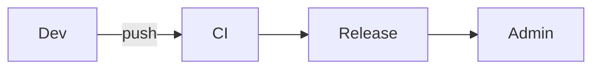

# Passo 03 — Componentes nos `.mdx`

> **Fase:** 02 — Conteúdo\
> **Tempo estimado:** 15 min\
> **Depende de:** [Passo 02](02-categorias-e-sidebar.md)

## Objetivo

Usar os recursos visuais do portal: alertas, abas, badges, ícones, blocos de
código com destaque e diagramas Mermaid.

## 💡 Componentes sem `import`

O arquivo `src/theme/MDXComponents.tsx` registra componentes **globais**: eles
funcionam em qualquer `.mdx` sem `import`. 💡 É a caixa de ferramentas que já
fica na bancada: você não precisa buscá-la no armário a cada página.

`frontend/src/theme/MDXComponents.tsx`:

```tsx
import MDXComponents from '@theme-original/MDXComponents';
import Tabs from '@theme/Tabs';
import TabItem from '@theme/TabItem';
import DocCardList from '@theme/DocCardList';
import Badge from '@site/src/components/Badge';
import TechIcon from '@site/src/components/TechIcon';
import CategoryGrid from '@site/src/components/CategoryGrid';

// Componentes disponíveis em qualquer .mdx sem precisar de import.
export default {
  ...MDXComponents,
  Tabs,
  TabItem,
  DocCardList,
  Badge,
  TechIcon,
  CategoryGrid,
};
```

A vitrine completa, com o resultado visual de cada item, é a página
**Guia de estilo** do próprio portal (`/portal/docs/guia-de-estilo`).

## Pré-requisitos

- Passo 02 concluído.

## Passo a passo

### 1. Alertas (*admonitions*)

```mdx
:::tip[Dica]
Texto do alerta.
:::
```

| Tipo | Cor | Use para |
|---|---|---|
| `note` | roxo | Observação neutra |
| `tip` | verde | Recomendação |
| `info` | azul | Contexto |
| `warning` | laranja | Armadilha comum |
| `danger` | vermelho | Risco de perder dados ou quebrar algo |

### 2. Abas (um bloco por sistema operacional)

```mdx
<Tabs groupId="os">
  <TabItem value="linux" label="Linux" default>

  ```bash
  sudo apt install -y pacote
  ```

  </TabItem>
  <TabItem value="macos" label="macOS">

  ```bash
  brew install pacote
  ```

  </TabItem>
</Tabs>
```

💡 O mesmo `groupId="os"` em várias páginas **lembra a escolha**: quem clicou em
macOS uma vez vê macOS em todas as abas do portal.

### 3. Badges e ícones de tecnologia

```mdx
<Badge color="green">estável</Badge>
<TechIcon icon="docker/docker-original" alt="Docker" />
```

- Cores do `Badge`: `orange`, `pink`, `red`, `purple`, `green`, `blue`, `cyan`, `gray`.
- O `icon` do `TechIcon` é o caminho no [Devicon](https://devicon.dev/) sem `.svg`
  (`<pasta>/<arquivo>`). Abra `https://cdn.jsdelivr.net/gh/devicons/devicon@latest/icons/<icon>.svg`
  para conferir se o ícone existe antes de usar.

### 4. Código com destaque de linhas

````mdx
```bash title="Comandos"
docker build -t app .
# highlight-next-line
docker run -p 8080:80 app
# error-next-line
docker run app --privileged
```
````

| Comentário | Efeito |
|---|---|
| `highlight-next-line` / `highlight-start` … `highlight-end` | Destaque laranja |
| `error-next-line` / `error-start` … `error-end` | Linha incorreta (vermelho) |
| `success-next-line` / `success-start` … `success-end` | Linha correta (verde) |

### 5. Diagramas Mermaid

````mdx

````

## Arquivos criados ou alterados

Nenhum (referência).

## ✅ Como testar

| # | Teste | Resultado esperado |
|---|---|---|
| 1 | Cole um exemplo de cada item numa página de rascunho e rode `npm start` | Cada item aparece como no Guia de estilo |
| 2 | Alterne o tema (sol/lua) | Alertas, código e Mermaid legíveis nos dois temas |

**Critério de aceite:** os 2 testes passam.

## ⚠️ Problemas comuns

| Sintoma | Causa provável | Solução |
|---|---|---|
| Código dentro de `<TabItem>` aparece como texto corrido | Falta linha em branco antes e depois do bloco | Deixe uma linha vazia em volta do ` ``` ` |
| Ícone quebrado (imagem vazia) | Caminho inexistente no Devicon | Confira a URL do item 3 |
| Mermaid aparece como código | Bloco sem a linguagem `mermaid` | Use ` ```mermaid ` |

## Commit sugerido

Nenhum (referência).

## Referências

- [Docusaurus — Admonitions](https://docusaurus.io/docs/markdown-features/admonitions)
- [Docusaurus — Tabs](https://docusaurus.io/docs/markdown-features/tabs)
- [Docusaurus — Code blocks (magic comments)](https://docusaurus.io/docs/markdown-features/code-blocks#custom-magic-comments)
- [Docusaurus — Diagrams (Mermaid)](https://docusaurus.io/docs/markdown-features/diagrams)

---

← [Passo anterior](02-categorias-e-sidebar.md) · [Índice da fase](README.md) · [Fase 03](../03-tema-e-configuracao/README.md) →
